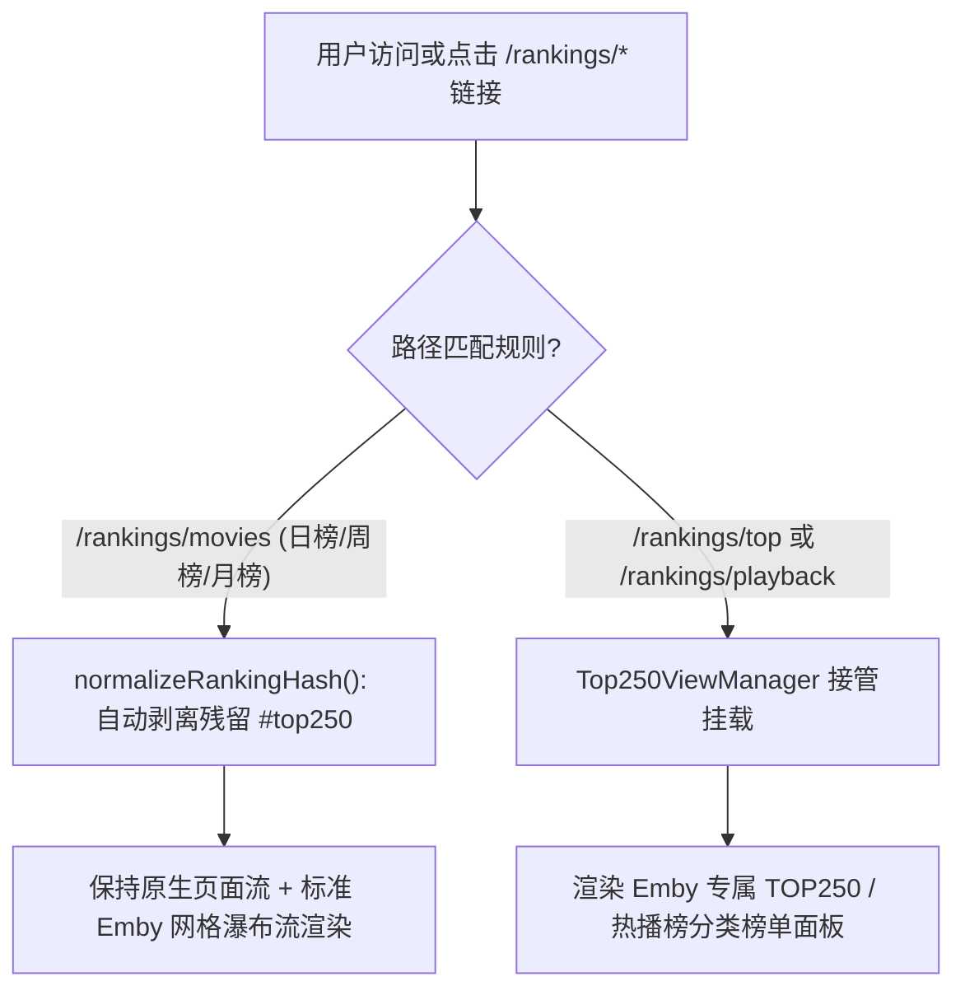
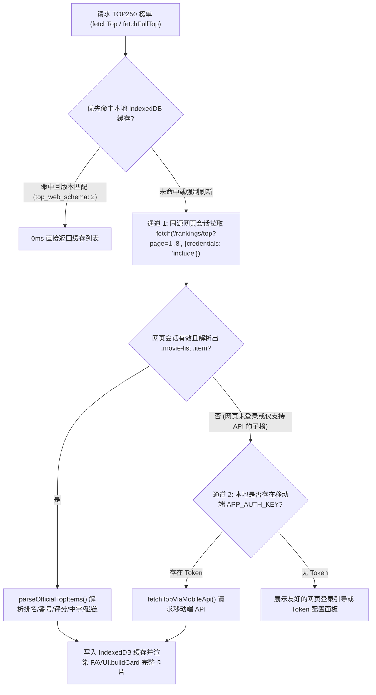

# 0029. 排行榜路由精确解耦、TOP250 网页登录态优先拉取与运行时高频节流架构 (Rankings Route Decoupling, Web-Session Priority TOP250 & Runtime Throttling Architecture)

## 状态
已接受 (Accepted)

## 上下文与问题陈述 (Context & Problem Statement)

在 `JavdbEmbySkin` 的长期演进与日常重度使用过程中，围绕排行榜路由调度、TOP250 鉴权链路、DOM 突变监听以及高频交互事件，暴露出以下影响用户体验与运行性能的核心痛点：

1. **常规影片排行榜（`/rankings/movies`）被 TOP250 视图误劫持**：
   * JAVDB 官方存在两类路径前缀相近但业务语义截然不同的榜单：`/rankings/movies`（按日榜、周榜、月榜切换的常规影片热度排行）与 `/rankings/top`（TOP250 殿堂荣誉榜）、`/rankings/playback`（热播榜）。
   * 早期路由守卫与链接点击拦截器将 `/rankings/movies` 一并归入了 `Top250ViewManager` 的接管范围，甚至自动为其附加 `#top250` Hash，导致用户在点击“日榜 / 周榜 / 月榜”时被强制劫持到 TOP250 面板，无法正常浏览常规影片排行。
2. **浏览器已登录 JAVDB 网页端，却因未配置移动端 API Token 而无法查看 TOP250**：
   * 既有 `Top250ViewManager` 完全依赖移动端私有 API（`jdforrepam.com/api/v1/rankings`）及用户手动抓取的 `Bearer Token`（`jhs_app_auth_token`）。
   * 对于绝大多数已在浏览器中正常登录 JAVDB 网页版（具备有效 Cookie 会话）、但从未配置过移动端 API Token 的用户而言，点击 TOP250 会直接被鉴权弹窗阻断，造成“明明已登录网页却看不了网页自带榜单”的割裂体验。
3. **非 Token 鉴权异常导致已保存的移动端 Token 被误删**：
   * 当请求因网络波动、网页会话过期或服务端临时错误返回包含泛化词根（如 `登`、`token`、`auth`、`過期`）的报错信息时，`loadData()` 会无差别执行 `localStorage.removeItem(APP_AUTH_KEY)`，导致用户辛苦配置的移动端 Token 被意外清空。
4. **纯图标版 VIP 徽章漏判与跨层级 DOM 插入隐患**：
   * 部分页面主题或响应式布局下，导航栏仅渲染钻石/皇冠等纯图标徽章而不含显式 `"VIP"` 文本，导致 `isJavdbVipUser()` 将真实 VIP 会员误判为普通用户；
   * 首页导航栏注入时，若查找到的锚点元素嵌套在深层子节点而非容器的直接子节点，直接调用 `parent.insertBefore(node, anchor)` 会抛出 `DOMException: NotFoundError`。
5. **长列表滚动与多图加载时的主线程卡顿（Main-Thread Jank）**：
   * 全局 `MutationObserver` 对任何细微 DOM 变动均触发无差别的页面重构与全文档 `img` 重扫；
   * 卡片悬停 3D 倾斜在每次 `mousemove` 中高频调用 `getBoundingClientRect()` 触发同步回流（Forced Synchronous Layout），瀑布流多张封面并发加载完成时连续触发数十次离散重排；
   * 公告与广告扫描器在大列表页使用 `querySelectorAll('body *')` 与全量 `div/span` 文本遍历，带来显著的 GC 与主线程阻塞开销。

---

## 核心修复与优化设计 (Core Architectural Solutions)

### 1. 排行榜路由边界解耦与残留 Hash 自愈（Route Boundary Isolation）

我们将排行榜路由严格拆分为两个互不干扰的视图通道：

* **精确路由匹配**：在 `hookNativePage()`、全局链接点击拦截器及 `runRoutePipeline()` 中，仅当路径匹配 `/^\/rankings\/(?:top|playback)\b/i` 时才激活 `Top250ViewManager`；
* **残留状态自愈**：新增 `normalizeRankingHash()`，在脚本启动与每次路由切换时检查当前路径；若处于 `/rankings/movies` 却携带历史遗留的 `#top250` 锚点，立即通过 `history.replaceState` 将其无感剥离，恢复常规影片排行榜的独立浏览与筛选。

---

### 2. TOP250 网页登录态优先（Cookie 直连）与移动端 Token 双轨容灾架构

为了彻底消除“网页已登录却仍需手动配置 Token”的门槛，我们将 `Top250ViewManager` 重构为**“网页会话优先 + 移动端 API 兜底”**的双轨数据源架构：

* **网页端多页并发拉取与 HTML 卡片流解析**：
  * 通过 `fetchOfficialTop(type, page, forceRefresh)` 携带同源 Cookie（`credentials: 'include'`）拉取 `/rankings/top?period=...&page=1..8`；
  * `parseOfficialTopItems(html, pageNo)` 使用 `DOMParser` 离线解析 `.movie-list .item` 节点，精准提取作品 ID、番号、标题、封面 URL、金标排名、评分星级/人数以及“含中字 / 含磁链”标签，并标记 `top_web_schema: 2`；
* **完整保留高级卡片特性**：
  * 无论是通过网页会话还是移动端 API 获取的数据，上层 UI 统一走 `FAVUI.buildCard` 渲染完整媒体库卡片（支持磁链角标、评分、快速收藏），并由 `syncTop250Details` 在后台静默补全演员与详细元数据；
* **插件开关解耦**：
  * 移除 `reviewListInfinite`（列表无限滚动开关）对 `Top250ViewManager` 挂载的前置阻断，确保无论用户是否开启无限滚动，Emby 导航栏中的 TOP250 视图始终可用；
* **移动端 Token 防误删守卫**：
  * 在 `Top250ViewManager.loadData()` 中，仅当接口明确返回 `res.action === 'JWTVerificationError'` 时才清除 `localStorage` 中的 `APP_AUTH_KEY`；网页登录态失效（`OfficialSessionError`）或临时网络超时绝不触碰已保存的移动端 Token。

---

### 3. DOM 观察器分级防抖、增量扫描与 TreeWalker 预算控制

针对高频 DOM 变动与页面扫描带来的 CPU 峰值，实施三层减负策略：

1. **MutationObserver 相关性预筛与分级防抖**：
   * 新增 `hasRelevantPageMutation(muts)` 预筛器，忽略纯皮肤自身控件（`SKIN_CHROME_SEL`）与无关属性变动，仅在新增节点命中 `.video-detail, .movie-list, .emby-row, .item, .box, .tile-images` 等核心内容节点时才触发回调；
   * 实施按页面类型分级防抖：**详情页采用 `90ms` 极速响应**以保障紧凑布局顺滑成型，**列表页采用 `500ms` 稳健防抖**以合并无限滚动批量节点注入；
   * 移除末尾冗余的 `setInterval(checkRouteChange, 900)` 定时轮询，完全依靠 `popstate`、`turbolinks:load`、`turbo:load` 与 `history.pushState/replaceState` 事件驱动。
2. **局部作用域增量防盗链注入（Scoped `no-referrer`）**：
   * 将 `ensureImageNoReferrer(scope)` 改造为接收局部根节点，在 `MutationObserver` 回调中仅针对本次新增的 `addedNodes` 子树补充 `referrerpolicy="no-referrer"`，告别每次 DOM 微调即遍历全文档 `img` 的 $O(N)$ 开销。
3. **TreeWalker 流式预算扫描与去广告路由节流**：
   * 将 `hideJavdbAnnouncement()` 的兜底扫描从 `Array.from(document.querySelectorAll('body *'))` 重构为 `document.createTreeWalker(document.body, NodeFilter.SHOW_ELEMENT, null)`，并设置单次最多检查 `2500` 个节点的硬预算上限；
   * 为 `hideJavdbAds()` 引入按路由键隔离的 `250ms` 节流锁，补全 `nav.app-desktop-banner, nav.app-mobile-banner` 顶部横幅规则，并将推广文本正则扫描的选择器从全量 `div, span, a` 收敛至 `.tag, .badge, [data-ad], [class*="moj-"], [class*="sda-"]`。

---

### 4. 交互事件 RAF 帧同步、几何测量缓存与 IndexedDB 批量事务

1. **单帧节流与零重排 3D 倾斜**：
   * 为 `bindNoteTips` 的 `mouseover` 事件及全局滚动监听 `window.__embyScrollHandler` 加上 `requestAnimationFrame` 单帧锁（配 800ms 超时自愈守卫）；
   * 在 `attachCompactPoster3D` 中，改为在 `mouseenter` 阶段一次性读取并缓存 `poster.getBoundingClientRect()`，使整个 `mousemove` 倾斜动画期间实现 **0 次同步布局读取**；
   * 在 `WaterfallEngine.register` 的图片 `load` 事件中增加 `70ms` 聚合定时器（`reg.imgTimer`），将多图同时加载完成时的连续重排合并为单次布局计算；
   * 新增 `@media (prefers-reduced-motion: reduce)` 样式支持，尊重系统级无障碍动画减弱偏好。
2. **非阻塞字体加载与 IndexedDB 单例复用**：
   * 新增 `ensureFontLinks()`，通过 `<head>` 动态注入 `<link rel="preconnect">` 与 `<link rel="stylesheet">` 异步加载字体，移除 CSS 文本内的阻塞式 `@import`；
   * 在 `Top250ViewManager` 内复用单例 `dbConnection / dbOpenPromise`，并提供 `setCachedMany(entries)` 单事务批量写入接口，将原先 `cacheMovieDetail` 的 4 次独立 IDB 事务收敛为 1 次原子事务。

---

### 5. 网络在途去重（In-Flight Deduplication）、AbortSignal 中断与多级缓存保留

在网络调度层，我们遵循**“去重防抖而不限流卡死”**的原则：

* **同 URL 在途请求合并 (`embyNetRun`)**：
  * 当多个组件或快速悬停在极短时间内对同一 URL 发起 `GET` 请求时，自动复用同一个在途 Promise，避免重复发包；
  * 遇到 `HTTP 429 / 403` 或网络超时时，自动执行带随机抖动（Jitter）的指数退避重试；
  * **严禁设置低并发全局硬上限**：不引入类似“全局最多 3 并发”的队列锁，防止后台番号评分抓取阻塞前景瀑布流封面与剧照加载。
* **支持 `AbortController` 穿透中断 (`gmHttp` & `PreviewSys`)**：
  * 升级 `gmHttp` 支持传入 `signal`（触发 abort 时立即调用 `GM_xmlhttpRequest` 的 `abortHandle.abort()`），配合 `netTimeoutRace` 在超时后真正释放底层网络连接；
  * 使用 `memCacheSetCapped` 对内存映射表（`PreviewSys.cache` 上限 400 项、`scoreMemCache` 上限 500 项）实施 FIFO 容量封顶；
  * **完整保留 L2 持久化缓存与全图源**：严格保留 `PreviewSys` 的 7 天 IndexedDB L2 本地持久化缓存与 `ProjectJav` 等全部高清剧照嗅探源，确保二次访问 0ms 瞬开体验不退化。

---

## 架构效果与收益 (Consequences & Benefits)

* **榜单导航边界清晰**：常规影片排行榜（`/rankings/movies` 日榜/周榜/月榜）与 TOP250 荣誉榜（`/rankings/top`）彻底解耦，各自保持独立的视图形态与筛选交互，残留的 `#top250` 锚点可自动无感自愈；
* **TOP250 开箱即用且凭据安全**：已登录 JAVDB 网页版的用户无需手动抓包配置移动端 Token 即可直接浏览完整 TOP250 榜单，且网络波动或网页会话过期时绝不会误清空用户已保存的移动端 Token；
* **主线程帧率与内存稳定性显著提升**：通过 MutationObserver 相关性预筛、增量 `no-referrer` 注入、`TreeWalker` 节点预算控制、3D 几何测量缓存以及网络在途去重，彻底消除了长列表无限滚动与高频悬停时的同步回流抖动与全表扫描开销。
